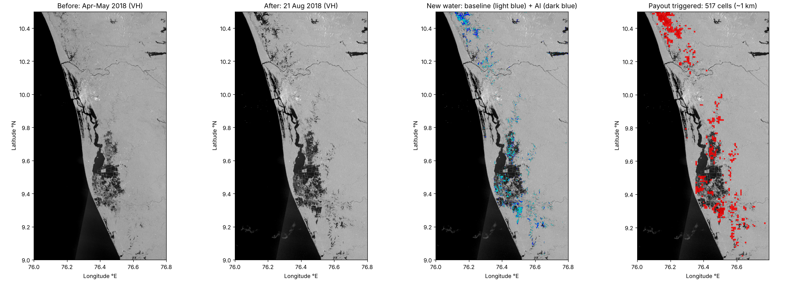

# OrbitWise run report

Generated 2026-11-26 02:10. All numbers below come from this run.

## Track A · 1. Flood AI (water IoU: overlap ÷ union with expert labels; 1.0 = perfect)

| method                        |   Indian floods (test) |   Test floods |   Unseen flood (Bolivia) |
|:------------------------------|-----------------------:|--------------:|-------------------------:|
| AI (Gradient Boosting)        |                  0.698 |         0.575 |                    0.608 |
| Fixed threshold (VH < -20 dB) |                  0.66  |         0.462 |                    0.619 |
| Hybrid (AI + Otsu)            |                  0.715 |         0.562 |                    0.664 |
| Otsu threshold                |                  0.716 |         0.506 |                    0.695 |

## Track A · 2. Kerala flood, 21 Aug 2018

| | Baseline (UN-SPIDER) | AI |
|---|---|---|
| New water (km²) | 217 | 68 |
| Of which farmland (km²) | 142 | 45 |
| Alappuzha + Kottayam box (km²) | 134 | 34 |

IWMI / UN-SPIDER measured 407 km² in Alappuzha + Kottayam on 14 Aug 2018 (flood peak; water receded by 21 Aug).

## Track A · 3. Payout (trigger: ≥ 30% of a ~1 km cell's farmland newly flooded)

| | Baseline | AI |
|---|---|---|
| Cells with farmland | 1240 | 1240 |
| Cells triggered | 517 | 138 |
| Hectares to pay | 11,979 | 2,422 |
| Payout (₹ crore) | set sum_insured_per_ha | set sum_insured_per_ha |

PMFBY: claims are stipulated to be paid within two months of crop-cutting experiments / harvest (PIB, Ministry of Agriculture & Farmers Welfare, 19 Jul 2022). This trigger is computed minutes after the satellite pass.

## Track B · 4. Collision risk, 2 days before closest approach (real ESA Kelvins data)

|                                   |   caught |   dangerous |   precision |   recall |    F2 |   alerts |
|:----------------------------------|---------:|------------:|------------:|---------:|------:|---------:|
| Do nothing (trust 2-day-old risk) |        8 |          13 |       0.129 |    0.615 | 0.351 |       62 |
| AI (Gradient Boosting)            |        9 |          13 |       0.117 |    0.692 | 0.349 |       77 |

Alert cut-off 0.1. Alerts on the 2,167 ESA test events: {'LOW': 1847, 'HIGH': 269, 'MEDIUM': 51}.

## Track B · 5. Debris screen: 11 satellites vs 14,334 objects, 72 h from 2026-11-25 12:35 UTC

| satellite   | object           |   closest_km |   relative_speed_km_s | time_utc            | object_type      |
|:------------|:-----------------|-------------:|----------------------:|:--------------------|:-----------------|
| CARTOSAT-2D | RASSVET-3 15     |         1.29 |                 15.22 | 2026-11-26 12:44:00 | active satellite |
| CARTOSAT-2E | RASSVET-3 5      |         1.3  |                 15.22 | 2026-11-27 07:48:47 | active satellite |
| SENTINEL-1C | IRIDIUM 33 DEB   |         1.38 |                 14.53 | 2026-11-27 10:04:19 | debris           |
| CARTOSAT-2E | KONDOR-FKA NO. 1 |         1.48 |                 13.94 | 2026-11-27 22:14:44 | active satellite |
| CARTOSAT-2F | RASSVET-3 6      |         1.83 |                 15.19 | 2026-11-27 08:11:50 | active satellite |
| CARTOSAT-2C | 2023-091P        |         2.05 |                  0.43 | 2026-11-26 06:24:29 | active satellite |
| CARTOSAT-2A | KUIPER-00493     |         2.09 |                  5.91 | 2026-11-27 04:37:29 | active satellite |
| CARTOSAT-2A | KUIPER-00500     |         2.17 |                 12.79 | 2026-11-25 21:13:47 | active satellite |
| CARTOSAT-2B | KUIPER-00594     |         2.19 |                  6.17 | 2026-11-25 14:17:08 | active satellite |
| CARTOSAT-2D | RASSVET-3 8      |         2.25 |                 15.18 | 2026-11-26 08:48:26 | active satellite |

Public orbit data (TLEs) carry errors of a kilometre or more: these are screening candidates, the step before an operator requests precise data.
